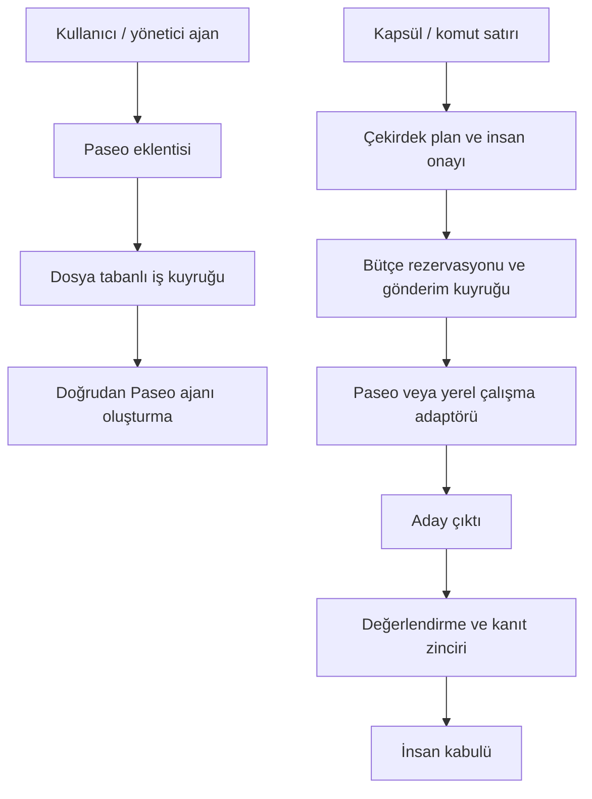

# Ordu — Uçtan Uca Teknik Değerlendirme Raporu

**Tarih:** 27 Ekim 2026  
**Hazırlayan:** ChatGPT  
**Amaç:** Kullanıcının “projeye hâkim misin, uçtan uca oku ve değerlendir” talebi üzerine sunulan değerlendirmenin kalıcı kaydı.  
**Kapsam:** Çekirdek orkestrasyon, Paseo eklentisi, pano, testler, kanıt kayıtları, işletim betikleri ve hedef–uygulama uyumu.

> **Kanıt sınırı:** Teknik değerlendirme salt-okuma kaynak incelemesine dayanır. Bu değerlendirme kapsamında yeni çekirdek test süiti, canlı sağlayıcı koşumu veya Git geçmişinden üretim hızı ölçümü yapılmadı. Mevcut test ve canlı koşum sonuçları, kaynak raporların kayıtları olarak aktarılır; bu raporun ürettiği yeni ölçümler değildir. Raporun diske kaydedilmesi için yapılan dokümantasyon ve sağlık kontrolleri, teknik bulguların canlı yeniden sınanması anlamına gelmez.
>
> **Etiketler:** (R) kaynakta kayıtlı resmî ölçüm; (T) değerlendirme, tahmin veya öneri; * tek-kaynak bulgu. Statik kod bulguları çalışma anında yeniden üretilmiş hata kanıtı olarak sunulmaz. Bu belge hedef, plan veya kabul defterinin yerine geçmez; inceleme anının fotoğrafıdır.

## 1. Genel hüküm

**(T) Proje boş bir iskelet değil. Gerçek güvenlik kapıları, kalıcı defteri, hata senaryoları ve dar kapsamlı canlı koşum kanıtları bulunan ciddi bir çekirdek var. Ancak henüz bütün giriş yolları aynı güven zincirinden geçen, “hedefi ver; güvenle kendi başına bitirsin” denebilecek birleşik bir ürün yok.**

Temel sorun tek tek özelliklerin yokluğundan çok, mevcut parçaların aynı zorunlu yürütme ve kabul hattında birleşmemesi. Çekirdek tarafında güçlü olan korumalar, eklentinin günlük ajan oluşturma yolunda otomatik olarak geçerli olmuyor. Benzer şekilde korunan değerlendirici mevcutken günlük komut satırı değerlendirmesi daha dar bir doğrulama yapıyor.

Kısa hüküm: **İyi temellendirilmiş, dar işleri kanıtlanmış bir pilot; genel amaçlı güvenli otonom ürün henüz değil.**

## 2. Gerçekte iki yürütme yolu var

İlk yolun kaynakları: [`plugin/index.server.ts`](../plugin/index.server.ts:251), [`orduDongu()`](../plugin/server/ordu.ts:119). İkinci yolun kaynakları: [`cliMain()`](../core/src/cli.ts:63), [`dispatchNode()`](../core/src/supervisor.ts:102), [`processOutbox()`](../core/src/dispatcher.ts:37).

**(T) Ana mimari açık, üstteki yolun alttaki kapıları zorunlu olarak kullanmamasıdır.** Bir çekirdek kapısının bulunması, ürünün bütün giriş yollarının o kapıyla korunduğu anlamına gelmez.

## 3. Güçlü taraflar

| Alan | Kaynak incelemesinde görülen güçlü taraf | Kaynak |
|---|---|---|
| Veri bütünlüğü | İşlemler, komut kimliği çakışma kontrolü ve kalıcı olay kaydı; yalnız sohbet belleğine dayanmıyor. | [`store.ts`](../core/src/store.ts:42) |
| Çift iş ve eski sahip koruması | Gönderim rezervasyonu, tekilleştirme ve monoton sahiplik belirteci; eski sahibin aday/kanıt yazması reddediliyor. | [`reserveDispatch()`](../core/src/store.ts:162), [`commitCandidate()`](../core/src/store.ts:201), [`recordEvidence()`](../core/src/store.ts:226) |
| Onay sınırı | Çekirdekte plan onayı ile gönderim ayrılmış; kabul de ayrıca karar kapısından geçiyor. | [`approvePlan()`](../core/src/supervisor.ts:84), [`decideApproval()`](../core/src/supervisor.ts:241) |
| Belirsiz sonuç yönetimi | Sonucu bilinmeyen başlatma için ayrı uzlaştırma yolu var; körlemesine yeniden ajan başlatmak tek seçenek değil. | [`reconcileUnknown()`](../core/src/dispatcher.ts:152) |
| Sahte başarıya direnç | Korunan değerlendirici yalnız başarılı çıkış koduna güvenmiyor; test sayısı ve başarısızlık bilgisi istiyor. | [`evaluateAttempt()`](../core/src/evaluator.ts:28) |
| Kanıt bağları | Çıktı, deneme, değerlendirici, ortam, plan/politika, vekâlet ve sahiplik bağlarını denetleyen ayrı mekanizma var. | [`verifyReceiptLinks()`](../core/src/receipt-link.ts:70) |
| Paseo bağımsızlığı | Yerel çalışma adaptörü ve ayrı Git çalışma ağacı üzerinden yürütme mevcut; çekirdek bütünüyle Paseo'ya mahkûm değil. | [`LocalCliLauncher`](../core/src/local-runtime.ts:85), [`LocalRuntimeAdapter`](../core/src/local-runtime.ts:253) |
| Öğrenme ve plan yenileme | Dersin önerilmesi, doğrulanması ve yayımlanması ayrılmış; plan yenileme ve kural derleme için insan kapıları var. | [`lessons.ts`](../core/src/lessons.ts:171), [`replanOnayla()`](../core/src/replan.ts:292), [`kuralOnayla()`](../core/src/kural.ts:294) |

Testler yalnız mutlu yolu anlatmıyor: [`e2e-s11.test.ts`](../core/test/e2e-s11.test.ts:171) bağımsız kanıtı olmayan veya bağımsız değerlendirmesi başarısız olan işçinin başarı iddiasını reddeden senaryolar içeriyor. [`a2-replan.test.ts`](../core/test/a2-replan.test.ts:127) insan onayı ve yetki sınırını, [`cli-capsule.test.ts`](../core/test/cli-capsule.test.ts:110) olumsuz komut satırı girdilerini kapsıyor.

**(R)* Mevcut canlı kanıt kaydı:** [`a05-lrt-2026-10-27.md`](kanit-hedef/a05-lrt-2026-10-27.md:27) gerçek yerel sağlayıcı koşumlarını ve kırıl–ölç–düzelt zincirini kaydediyor. Bu, dar bir işin canlı çalışabildiğine dair kanıttır; bütün ürünün güvenli otonomluğunu kanıtlamaz.

## 4. Öncelikli bulgular

### 4.1. KRİTİK — Eklentinin emir yolu çekirdek kapılarını kullanmıyor

**Statik bulgu:** Eklenti zamanlayıcısı repo başına iş kuyruğunu tüketiyor. Kuyruk doğrulaması temel alanları ve eşzamanlı işçi sayılarını denetliyor; ardından doğrudan Paseo ajanı oluşturuluyor. Bu yolda çekirdeğin plan onayı, bütçe rezervasyonu ve genel durdurma mandalı denetimleri görünmüyor.

Kaynaklar: [`plugin/index.server.ts`](../plugin/index.server.ts:251), [`spawnDogrula()`](../plugin/server/ordu.ts:81), [`orduDongu()`](../plugin/server/ordu.ts:119). Karşılaştırılan çekirdek kapısı: [`dispatchNode()`](../core/src/supervisor.ts:102).

**(T) Sonuç:** “Çekirdekte onaysız gönderim engelleniyor” ifadesi doğru olsa bile “üründe onaysız hiçbir ajan çalışamaz” sonucu çıkarılamaz. Aynı şekilde çekirdekte durdurmak, paralel eklenti yolunu kendiliğinden durdurmaz.

**(T) Öncelik:** Bütün üretim ajan başlatmalarını tek çekirdek gönderim kapısına bağlamak. Eklenti emir ileten ve durum gösteren yüz olmalı; ayrı bir yürütme otoritesi olmamalı.

### 4.2. KRİTİK — Günlük değerlendirme yolu genel görev doğruluğunu kanıtlamıyor

**Statik bulgu:** Günlük komut satırı değerlendirmesi, dosyanın varlığı, boş olmaması, sembolik bağ olmaması ve isteğe bağlı metin içerme koşulu gibi kontroller yapıyor. Bunlar dar bir dosya üretme görevi için yararlı; genel bir yazılım görevinin doğruluğunu sınayan bağımsız testlerin karşılığı değil.

Kaynaklar: [`cliMain()` değerlendirme kolu](../core/src/cli.ts:196), [`evaluateArtifact()`](../core/src/cli-evaluate.ts:22). Daha güçlü ayrı yol: [`evaluateAttempt()`](../core/src/evaluator.ts:28).

Ek olarak karar kolu, gerekçelendirme makbuzunu gerçek çalışma çıktısından toplamak yerine örnek makbuz yardımcısıyla oluşturuyor: [`cli.ts`](../core/src/cli.ts:208), [`sampleReceipt()`](../core/src/reasoning-receipt.ts:52).

**(T) Sonuç:** Makbuz şemasının ve bağlantılarının doğrulanması, o makbuzun anlattığı işin anlamsal olarak doğru yapıldığını tek başına göstermez. “Dosya üretildi” ile “istenen iş doğru tamamlandı” ayrı kabul seviyeleridir.

**(T) Öncelik:** Günlük üretim yolunda onaylı test komutları, gerçek test sonucu, çıktı kimliği ve gerçek kanıttan türetilmiş makbuz zorunlu olmalı.

### 4.3. KRİTİK — Gerçek kullanım bütçe kapatmasına bağlanmamış

**Statik bulgu*:** Sonuç kapatma sırasında harcanan token miktarı sabit sıfır olarak rezervasyon kapatmasına veriliyor. Kaynak: [`settleNodeOutcome()`](../core/src/supervisor.ts:181). Rezervasyonun harcamayı işleyen tarafı: [`settleReservation()`](../core/src/store.ts:259).

**(T) Sonuç:** Rezervasyon mekanizmasının varlığı gerçek kullanım muhasebesinin tamamlandığı anlamına gelmiyor. Sıfırla kapatma, muhasebeye bağlanmayan kullanımı doğru temsil edemez. Bu bulgu bütün yolların sınırsız harcama yaptığının canlı kanıtı değil; güvenli bütçe iddiasının eksik bağıdır.

**(T) Öncelik:** Sağlayıcı kullanımını deneme kimliğine bağlamak; kullanım ölçülemiyorsa bunu açıkça bilinmeyen olarak tutmak ve politika sınırında güvenli durmak. “Ölçülemedi” ile “sıfır harcandı” aynı kayıt olmamalı.

### 4.4. YÜKSEK — Yerel çalıştırma, kapsülün repo ve commit kimliğine yeterince bağlı değil

**Statik bulgu:** Yerel başlatıcı ayrı bir Git çalışma ağacı oluşturuyor; bu önemli bir izolasyon adımı. Ancak başlatma sözleşmesinde kapsülün onaylı repo ve commit kimliği taşınmıyor. Başlatıcının kendi repo ayarıyla açtığı çalışma ağacının onaylanan kapsülle aynı kaynak kimliğine sahip olduğu zorunlu bağ olarak görünmüyor.

Kaynaklar: [`LocalCliLauncherOpts`](../core/src/local-runtime.ts:61), [`LocalCliLauncher.launch()`](../core/src/local-runtime.ts:117), [`LocalRuntimeAdapter.spawn()`](../core/src/local-runtime.ts:266), [`defaultAdapter()`](../core/src/cli.ts:38).

**(T) Sonuç:** Ayrı çalışma ağacı kullanmak ile tam olarak onaylanan kaynak üzerinde çalışmak farklı güvenceler. Repo/commit bağı eksikse yeniden üretilebilirlik ve kabul zincirinin ortam tarafı zayıflar.

**(T) Öncelik:** Onaylı kaynak kimliği başlatma sözleşmesine taşınmalı; çalışma ağacı bu kimlikten açılmalı; değerlendirme de aynı kimliği doğrulamalı.

### 4.5. YÜKSEK — Plan onayının özeti bütün iş sözleşmesini kapsamıyor

**Statik bulgu*:** Plan özeti düğüm kimliği, rol, bağımlılıklar, sağlayıcı ve model gibi alanlardan üretiliyor; hedef, repo, commit ve izinli komutlar bu özete dâhil değil. Kaynak: [`planHashOf()`](../core/src/supervisor.ts:30).

**(T) Sonuç:** Bu alanların başka yerde korunması mümkün olsa da yalnız bu özet, “insanın onayladığı iş sözleşmesinin tamamı budur” kanıtı olamaz. Aynı düğüm yapısı farklı hedef veya yürütme sınırları için aynı onay kapsamını temsil etmemeli.

**(T) Öncelik:** Onay kimliğini hedef, kaynak kimliği, izinler, değerlendirici, bütçe ve yürütme politikasıyla birlikte tanımlamak; kapsamdaki değişikliği açık yeni onaya veya daraltma yetkisine bağlamak.

### 4.6. YÜKSEK — Sağlık, plan yenileme ve gözetimsiz rozetinde tanım farkları var

**Statik bulgu — kabul rengi:** Sağlık betiği hermetik geçişi canlı kabul oranına katmıyor. Plan yenileme motorunun yeşil kümesi ise hermetik geçişi de içeriyor. Kaynaklar: [`saglik.ps1`](../scripts/saglik.ps1:127), [`replan.ts`](../core/src/replan.ts:30).

**(T) Sonuç:** Aynı kabul defteri bir yerde açık, diğer yerde kapanmış sayılabilir. Farklı ölçütler bilinçli tasarım olabilir; fakat adları ve kullanımları ayrılmadan ortak “yeşil” gibi yorumlanırsa plan sapması ölçümü yanıltır.

**Statik bulgu* — iptal eşlemesi:** Teyitsiz iptal hesabı deneme kimliği yerine çalışma kimliği üzerinden karşılaştırma yapıyor. Kaynak: [`teyitsizIptalSayisi()`](../core/src/gozetimsiz.ts:42).

**(T) Risk:** Bir çalışmanın birden çok denemesi olduğunda bir denemenin ölüm teyidi diğerinin eksik teyidini örtebilir. Deneme bazlı olumsuz test gerekli.

**(T) Öncelik:** Canlı kabul, hermetik doğrulama ve plan tutarlılığı için ayrı, açık tanımlar; iptal kanıtında deneme bazlı bağlama.

## 5. Ek teknik ve işletim notları

- **Rol başlığı uyuşmazlığı:** Eklenti işçi başlığını rol ve görev metnini ayıran bir biçimde oluşturuyor; rol çözümleyici ise köşeli parantezli rol öneki bekliyor. Kaynaklar: [`orduDongu()`](../plugin/server/ordu.ts:119), [`rolCoz()`](../plugin/server/roller.ts:44). **(T)** Tanınmayan rolün izin sınırları olumsuz testle doğrulanmalı; başlığa rol yazmak tek başına rol politikasının uygulandığını göstermez.
- **Kuyruk tüketiminde çakışma riski:** Zamanlayıcı tekrarlarıyla çalışan okuma–ajan oluşturma–sonuç yazma zinciri atomik bir kuyruk sahiplenmesine dayanmıyor. Kaynaklar: [`plugin/index.server.ts`](../plugin/index.server.ts:251), [`orduDongu()`](../plugin/server/ordu.ts:119). **(T)** Uzayan çağrıda üst üste turların aynı işi sahiplenmesi sınanmalı; bu, gözlenmiş çift başlatma ölçümü değil, statik eşzamanlılık riskidir.
- **Satır bütçesi gerçek bağlam hacmini sınırlamıyor:** İnceleme haritasında durum belgesi 64,5 KB, dersler belgesi 88,4 KB olarak görünüyordu. Kaynak: [`CODEMAP.md`](../CODEMAP.md). **(T)** Az sayıda çok uzun satır, satır sayacı yeşilken bağlamı şişirebilir. Bayt/token hacmi ve kademeli okuma da izlenmeli. Bu boyutlar yeni token ölçümü değildir.
- **Başlatma hatasının gerekçesi:** Kalıcı hata sonucunda ayrıntılı gerekçenin deftere taşınması eksik görünüyor. Kaynak: [`processOutbox()` kalıcı hata kolu](../core/src/dispatcher.ts:137). **(T)** Operatörün sonradan neden durulduğunu çözmesi zorlaşır.
- **Sentetik oturum kimliği çelişkisi:** Uzlaştırmada sentetik kurtarma kimliği kullanılıyor; kabul defterindeki P0-7 iddiasıyla birlikte yeniden ele alınmalı. Kaynaklar: [`reconcileUnknown()`](../core/src/dispatcher.ts:152), [`kabul.csv`](../plans/kabul.csv). **(T)** Gerçek sağlayıcı oturumu kimliği ile yerel ilişkilendirme kimliği birbirine karıştırılmamalı.
- **Sürüm kilidi betiğinin eski yerleşim varsayımları:** Kök ve eklenti evlerini karıştıran dosya yolu varsayımları sürüyor. Kaynak: [`kilit-surum.ps1`](../scripts/kilit-surum.ps1:28). **(T)** Birleşik sürüm kapısı ilanından önce güncel monorepo yerleşiminde izole sınanmalı.

## 6. Ürün ve güvenlik sınırları

| Başlık | İncelemede görülen durum | Çıkarılmaması gereken sonuç |
|---|---|---|
| Çekirdek kapıları | Kodda gerçek ve ayrıntılı mekanizmalar var. | Bütün giriş yolları otomatik olarak bu kapılardan geçiyor. |
| Yerel yürütme | Ayrı çalışma ağacı ve gerçek sağlayıcı kanıtı var. | Her kapsül onaylı kaynak kimliğine eksiksiz bağlı. |
| Değerlendirici | Bağımsız test sonucunu doğrulayabilen güçlü modül var. | Günlük dosya kontrolü genel görev doğruluğunu kanıtlıyor. |
| Makbuz | Şema ve bağ denetimi var. | Geçerli biçimdeki her makbuz gerçek iş kanıtıdır. |
| Bütçe | Rezervasyon ve kapatma mekanizması var. | Gerçek sağlayıcı tüketimi bütün yollarda muhasebeleşiyor. |
| Gözetimsiz rozet | Kanıt tazeliği ve güvenli kapalı kalma yaklaşımı var. | Rozet bütün gerçek kullanım senaryolarını tek başına sertifikalandırıyor. |
| Pano ve eklenti | İşletim yüzleri ve komutlar var. | Tek, tutarlı ve uçtan uca bağlanmış kullanıcı ürünü tamamlandı. |

Bu tablo bir tamamlanma yüzdesi veya yeni performans ölçümü değil; kaynak incelemesinden çıkarılan kapsam değerlendirmesidir (T).

## 7. Mevcut aşama ve kayıtlı kanıtın anlamı

**(R)* Durum kaydında** çekirdek süiti 449/449, sağlık özeti 18 başarılı / 0 eksik / 2 uyarı ve canlı kabul 81/124, yuvarlanmış yüzde 65 olarak belirtiliyor. Kaynak: [`STATE_BOARD.md`](../STATE_BOARD.md:88). Bunlar kaynak belgedeki kayıtlı sonuçlardır; bu rapor için yeniden üretilmiş süit sonuçları değildir.

**(T) Bu sayılar değerli ama ürün tamamlanmasıyla aynı şey değil:**

- Test sayısı, üretim girişlerinin aynı güvenlik kapısından geçtiğini tek başına göstermez.
- Hermetik geçiş ile canlı kullanım kanıtının ayrılması doğru; iki sınıf sessizce tek kabul seviyesine çevrilmemeli.
- Dar kapsamlı gerçek sağlayıcı başarısı, uzun ve çok aşamalı görevlerde güvenli özerkliğin kanıtı değildir.
- Gözetimsiz sürücüye geçişte insan kapısının beklemesi, bütün entegrasyon risklerinin kapandığı anlamına gelmez.

**Aşama sınıflandırması (T):** Çekirdek için işleyen ve ciddi biçimde sertleştirilmiş pilot; ürün için entegrasyon ve güven zinciri tamamlama aşaması. Sıfırdan yeniden yazmak değil, mevcut parçaları zorunlu tek hatta toplamak gerekiyor.

## 8. Önerilen öncelik sırası

1. **Tek yürütme kapısı:** Eklenti, pano, zamanlayıcı ve komut satırından gelen bütün üretim başlatmaları çekirdek gönderim kapısından geçsin. Onay, durdurma ve bütçe denetimi giriş yolundan bağımsız olsun.
2. **Tam iş sözleşmesi:** Hedef, repo, commit, izinli işlemler, değerlendirici, bütçe ve politika onay kimliğine bağlansın; çalışma ortamı aynı kaynak kimliğinden açılsın.
3. **Gerçek kanıt ve kullanım:** Günlük üretim yolunda bağımsız test, gerçek makbuz ve sağlayıcı kullanımı zorunlu olsun. Bilinmeyen veri başarı veya sıfır harcama gibi yazılmasın.
4. **Otonom sürücü bundan sonra:** Planlama–işçi–değerlendirme–onarım–yeniden planlama döngüsü bu ortak kapılar üzerinde çalışsın. Yeni sürücü, mevcut paralel yolların üzerine ek bir yetki yolu açmasın.
5. **Gerçek kabul senaryoları:** Durdurma sırasında yeni başlatma, zaman aşımı, belirsiz oturum, iptal teyidi, eski sahip yazısı, bütçe tükenmesi, yanlış repo/commit, sahte başarı ve yeniden başlama sonrasında toparlanma gerçek giriş yolu üzerinden sınansın.
6. **Tek ürün ve sürüm kapısı:** Kullanıcı tek akıştan hedef versin, planı ve sınırları görsün, onaylasın, ilerlemeyi izlesin ve kanıtlı teslim alsın. Pano, eklenti, kabul defteri ve sürüm betikleri aynı tanımları kullansın.

Bunlar uygulama emri veya onaylanmış yeni plan değil, değerlendirme önerileridir (T). Bu rapor kapsamında üretim kodu, hedef, karar kaydı veya kabul durumu değiştirilmedi.

## 9. Önceki LOC/saat yanıtına düzeltme

Önceki konuşmada “commitlerden saatlik LOC hızı” başlığı altında verilen **370–1.110 LOC/saat** aralığı, gerçek Git geçmişi çıkarılıp ölçülerek hesaplanmış değildi. Kayıtlı kanal zamanları ve raporlanmış değişiklik hacimleri üzerinden türetilmişti.

**Bu nedenle Git'ten ölçülmüş resmî hız (R) olarak kullanılamaz; en fazla sınırlı bir tahmin (T) sayılabilir.**

Gerçek hız hesabında başlangıç–bitiş commit aralığı, geçen duvar saati, kod/test/doküman ayrımı, üretilmiş dosyalar, taşıma–yeniden biçimlendirme etkisi, paralel yazarlar ve yeniden işleme ayrıştırılmalı. İlgili ölçüm disiplini: [`K-0046.md`](../kararlar/K-0046.md:9).

**(T) Sonuç:** Önceki hız aralığına dayanılarak kesin teslim tarihi veya kalan saat taahhüdü çıkarılmamalı. Bu rapor yeni LOC/saat ölçümü sunmuyor.

## 10. Sonuç

**(T) Ordu'nun değerli tarafı, güvenliği yalnız bir istem talimatı olarak bırakmayıp veri modeli, durum makinesi, kalıcı defter ve testlerle kodlamaya çalışması. Eksik tarafı ise bu güvencelerin henüz bütün günlük kullanım yollarında zorunlu olmaması.**

Bir sonraki büyük kazanım daha fazla özellik eklemekten önce **tek yürütme hattı + tam onaylı iş sözleşmesi + gerçek test/kanıt/kullanım bağı** kurmak. Bunlar tamamlandıktan sonra otonom sürücünün büyütülmesi anlamlı ve denetlenebilir hâle gelir.

---

## 11. EK — Kullanıcının tam hedefi için ölçütlü puanlama

**Ek tarihi:** 27 Ekim 2026. Bu bölüm yeni kullanıcı talebiyle eklendi; önceki değerlendirme silinmedi veya yeniden yazılmadı. İlk 10 bölümdeki “bu değerlendirmede yeni test yapılmadı” sınırı o ilk incelemeye aittir. **Bu ekte seçilmiş yerel testler ve izole karakterizasyon deneyleri yeniden çalıştırıldı; tam regresyon ve canlı otonomi kampanyası çalıştırılmadı.**

### 11.1. Net cevap ve puan

> **(T) Bugünkü hâli, “görevi ver, unut; kendisi öğrensin, stratejisini değiştirsin, ölçerek çıtayı yükseltsin ve tamamlasın” hedefi için yeterli değil. Bunu kurmak için kullanılabilir ve değerli bir temel var; fakat hedeflenen kapalı döngü henüz tamamlanmış değil.**
>
> **Hedefe yönelik kanıtlanmış gereksinim endeksi: 46,25 / 100 puan — yuvarlanmış 46 / 100, yani 4,6 / 10 (T).**
>
> **Gözetimsiz üretim kararı: HAZIR DEĞİL.** Kritik bir güvenlik kapısını yüksek ortalama puan telafi edemez. Bu puan başarı olasılığı, bitmiş iş yüzdesi, kalan LOC yüzdesi veya bilimsel sertifika değildir.

Puan düşük diye çekirdek değersiz değil: kalıcı defter, onay kapıları, sahiplik koruması, uzlaştırma, sınırlı onarım, turnuva, kural derleme ve yerel yürütme gerçek parçalar. Ancak kullanıcının istediği şey **parçaların toplamı değil, bu parçaları gerçek görevde kendiliğinden ve güvenle birbirine bağlayan denetleyici**.

**Bilimsel netlik sınırı:** Kaynak incelemesinden evrensel bir “bilimsel proje puanı” çıkmaz. Burada yapılan; açık operasyonel tanımlar, tekrarlanabilir karşı örnekler, kaynak kimliği ve sayılabilir kontrol listesiyle **denetlenebilir mühendislik değerlendirmesi**. Rubrik ve ağırlıklar değerlendirmeci tasarımıdır (T); yerel deney gözlemleri ölçümdür (R). Rubrik sonuçlar görüldükten sonra oluşturulduğu için bu çalışma ön-kayıtlı, kör veya bağımsız bir deney değildir; sonraki sürüm karşılaştırmaları için başlangıç kaydıdır.

### 11.2. Hangi hedef değerlendirildi?

İstenen hedefi şu sonlu denetim döngüsü olarak tanımladım (T):

**Onaylı hedef/sınırlar → ölçülebilir alt görevler → güvenli yürütme → bağımsız görev doğrulaması → sınırlı onarım → gerekirse yeni yürütme planı → deneyle doğrulanmış öğrenme → yetki içi çıta yükseltme → sabit nihai hedefte kanıtlı tamamlanma veya gerekçeli güvenli duruş.**

Üç kritik ayrım:

1. **Zamanlayıcı ≠ hedef yöneticisi.** Mevcut periyodik tur; gönderim kuyruğunu işler, uzlaştırır, durum yoklar ve asılı işleri tarar. Kendiliğinden planlama, genel görev değerlendirmesi, onarım, öğrenme ve yeni hedef seçiminin birleşik çağırıcısı değildir. Kaynak: [`cliMain()` tur kolu](../core/src/cli.ts:109).
2. **Durum tazeleme ≠ stratejik yeniden planlama.** Mevcut motor kabul defteriyle planın durum hücrelerini eşleştiriyor. Yeni görev bağımlılıkları, alternatif çözüm stratejisi ve kaynak dağılımı üreten LLM turu dışarıda. Kaynak: [`replan.ts`](../core/src/replan.ts:1), [`replanTaslagi()`](../core/src/replan.ts:154).
3. **Ders yazmak ≠ öğrenmenin faydasını kanıtlamak.** Kalıcı ders/kural ve canary mekanizması var. Fakat yeni ve gizli görevlerde, aynı bütçede, öğrenmesiz tabana göre tekrarlanabilir iyileşme ayrı deney gerektiriyor. Kaynak: [`openLessonStore()`](../core/src/lessons.ts:171), [`A3 kanıtı`](kanit-hedef/a3-kural-derleyici-2026-10-27.md:17).

**Mevcut yetki sözleşmesiyle uyum:** Plan değiştirme, kural yayımlama ve nihai kabul insan kapılarına bağlı. Var olan sınırlı vekâlet; kendi başına kök hedefi, güvenlik politikasını veya genel kabul yetkisini genişletme izni değil. Kaynaklar: [`otonomi planı`](../plans/OTONOMI-MERDIVENI-PLANI-2026-10-26.md:96), [`replanOnayla()`](../core/src/replan.ts:292), [`assertGrantAllows()`](../core/src/grants.ts:203). **Bu değerlendirme talebi bu kuralları değiştirme veya ajan adına onay verme yetkisi olarak yorumlanmadı.**

### 11.3. Okunan raporlar ve bayat iddiaların ayrılması

Son raporla birlikte aşağıdaki **13 ilgili rapor**, yani toplam 14 rapor incelendi. Bütün tarihsel model benchmark dosyalarının veya bütün ham logların okunduğu iddia edilmiyor; seçim hedef döngüsü, karşı örnekler ve güncel kapanış kanıtına göre yapıldı.

| Kaynak | Bu değerlendirmeye etkisi |
|---|---|
| [`Son teknik değerlendirme`](rapor-chatgpt-27ekim.md:1) | Üretim yolları, değerlendirme ve muhasebe açıkları için başlangıç hipotezleri. |
| [`Canlı test sentezi`](canli-test-6subagent-2026-10-26/OZET.md:7) | Eski 4/8 hazırlık sınıflandırması; replan/derleyici yok iddiaları bugüne aynen taşınmadı. |
| [`10 ajanlı plan denetimi`](plan-kontrol-10subagent-2026-10-26/OZET.md:44) | Plan tutarlılığı ve damga düzeltmeleri; planın geçmesi ürünün geçmesi değil. |
| [`Kalıcı açık defteri`](kalici-acik-defteri-2026-10-26.md:27) | Eski komut/bağlantı eksikleri sonraki uygulamaya karşı ayrıştırıldı; eski sayımlar kullanılmadı. |
| [`A0-2 toparlanma`](kanit-hedef/a02-sweep-2026-10-27.md:26) | Asılı işlerin temizlenmesi için gerçek, dar üretim kanıtı. |
| [`A0-3 rozet besleme`](kanit-hedef/a03-gozetimsiz-besleme-2026-10-27.md:15) | “Kanıt üreticisi yok” eski iddiası geçersiz; 4 bayrağın beslenmesi tüm hedef döngüsü demek değil. |
| [`A0-5 yerel yürütme`](kanit-hedef/a05-lrt-2026-10-27.md:27) | 2 başarısız model keşfi ve 1 kabul edilmiş dar görev; 3 başarılı otonom görev diye sayılmadı. |
| [`A2 yeniden planlama`](kanit-hedef/a2-replan-2026-10-26.md:41) | Motor var; sınırı durum hücresi tazeleme ve insan onayı. |
| [`A3 kural derleyici`](kanit-hedef/a3-kural-derleyici-2026-10-27.md:17) | Gerçek kural inişi var; öğrenmenin genellenebilir fayda deneyi yok. |
| [`F8 turnuva`](kanit-hedef/f8-turnuva-2026-10-26.md:41) | Protokol ve sahte katılımcılı test verisi ayrıldı; beş gerçek modelin otomatik başarısı sayılmadı. |
| [`S7 iki sağlayıcı koşumu`](kanit-hedef/s7-turnuva-2026-10-27.md:39) | Gerçek dar görev ve operatör zinciri var; az örnek ve farklı düşünme ayarı nedeniyle nedensel üstünlük çıkarılmadı. |
| [`Hata enjeksiyonu matrisi`](fault-matrix-2026-10-25.md:9) | Gerçek süreç arızası sınamaları değerli; matris bütün ürün girişlerini kapsamıyor. |
| [`Bağımsız gözlemci`](gozlemci-n5-n5-2-2026-10-26.md:13) | Kanıt zinciri örneklemesi var; bütün defter satırlarının bağımsız sorgulandığı varsayılmadı. |
| [`Üç model puanlaması`](3model-puanlama-2026-10-19.md:5) | Model/erişim puanı ürünün otonomi puanı değil; önceki ortalama bu puana aktarılmadı. |

Aynı loga dayanan farklı raporlar bağımsız deney sayılmadı. Sonradan yalnız yeşil tekrarın seçilmesi başarı oranını yanlılaştırabileceği için önceki kırmızı koşular yok sayılmadı.

### 11.4. Bu ekte yeniden üretilen kanıtlar

**(R) Ölçüm penceresi:** 2026-10-27 20:56:34–20:56:39, Europe/Istanbul. Kaynak HEAD: **40b72a34834a6b0f741d845e43885130ca861a35**. Windows / Node 24.18.0. Başlangıçta çalışma ağacı kirliydi; bu nedenle HEAD tek başına yeterli kimlik sayılmadı, 28 ilgili kaynak/test/veri dosyasının SHA-256 kimlikleri kaydedildi ve koşu sonunda değişmedikleri kontrol edildi.

Tekrarlama aracı: [`rapor-chatgpt-27ekim-denetim.mjs`](rapor-chatgpt-27ekim-denetim.mjs:1). Ayrıntılar: [`deney-v2.json`](rapor-chatgpt-27ekim-deney-v2.json:1), [`deney-v2.log`](rapor-chatgpt-27ekim-deney-v2.log). Araç benzersiz çıktı adı ister; mevcut kanıtı ezmez. Komut ve çalışma dizini makine kaydında bulunur.

| Deney | Gözlenen sonuç (R) | Doğru yorum |
|---|---|---|
| P1 — İş sözleşmesi özeti | Aynı düğümler korunurken hedef, repo, commit ve izinli komutlar değiştirildi; plan özeti aynı kaldı. | Özet tam iş sözleşmesinin kimliği değil; bu tek başına donmuş kapsülün değiştirilebildiğini kanıtlamaz. |
| P2 — Bilinen yanlış sonuç | Hedef tam olarak toplam 10 iken toplam -999 içeren dosya, yalnız başlık alt dizgesi beklentisiyle 4 kontrolü geçti. | Günlük değerlendirici dar sözleşmesini yerine getiriyor; genel görev doğruluğu için yeterli oracle değil. Tek örnek hata oranı vermez. |
| P3 — Kullanım kapatma | Harcama ölçümü enjekte edilmeden sonuç kapandı; harcama sıfır, kullanım-bilinmiyor bayrağı kapalı kaldı. | Gerçek tüketim bağı eksik; deneyde sağlayıcı çalışmadığı için gerçek pozitif ücretin kaybolduğu iddia edilmez. |
| P4 — Kabul tanımı | Sağlık kümesi 81/124 = yüzde 65,32; yeniden planlama kümesi 112/124 = yüzde 90,32. | Fark 31 hermetik satır, yaklaşık 25 yüzde puanı. Farklı kümeler açık adlandırılmadan aynı hedef sinyali olamaz. |
| P5 — Stratejik replan | Sapma eşiği aşımı verilince tetik oluştu; bayat durum hücresi yoksa öneri sayısı 0 oldu. | Durum tazeleme var; salt başarısızlık/sapma üzerinden yeni yürütme stratejisi üretimi gösterilmedi. |
| P6 — İptal eşlemesi | Aynı çalışma içinde 2 deneme için iptal istendi, yalnız 1'i teyit edildi; “iptal doğrulanmış” koşulu geçti. | Çalışma düzeyindeki eşleme, deneme düzeyinde kalan teyitsiz iptali örtebiliyor. Bu deney tüm rozetin yeşil olduğunu söylemez. |

**(R) Yerel sınama:** 7 seçilmiş test dosyasında **88/88 geçti**, başarısız/iptal/atlanan/bekleyen 0. Kapsam: defter, denetleyici, eşlenmiş benchmark, dersler, turnuva, replan ve kural derleyici. Bunlar 88 bağımsız müşteri görevi değil; tam süitin 449/449 yeniden koşulduğu da iddia edilmiyor. Gerçek sağlayıcı, üretim veritabanı veya çalışan daemon çağrılmadı.

**(R) Bağımsız sayım:** Yerel ayrıştırıcı ve PowerShell CSV okuması aynı sonucu verdi: 124 satır; canlı-kabul kümesi 81, hermetik 31, çalıştırılmamış 11, kısmi 1. Bu yeni denetimin çift sayımı, ürünün sürekli çift-sayım özelliğine sahip olduğunun kanıtı değildir.

**Ölçerin kendi hatası:** İlk denetim koşusunda testler 88/88 geçmesine rağmen çıktı biçimi ayrıştırması sayıları boş kaydetti. İlk [`deney.json`](rapor-chatgpt-27ekim-deney.json) ve [`deney.log`](rapor-chatgpt-27ekim-deney.log) korundu. Araç açık raporlayıcı ve eksik-sayaç reddiyle düzeltildi; v2 ayrı dosyalara yeniden ölçüldü. Böylece ölçüm hatası sessizce başarıya çevrilmedi.

### 11.5. Puanlama yöntemi — denetlenebilir 40 koşul

**Rubrik kimliği: ORDU-OTONOMI-HEDEF-v1 (T).** 10 eksen, her eksende 4 eşit alt koşul. Her koşulda belirtilen kapsamı destekleyen uygulanmış mekanizma/test/iz varsa 1; yalnız plan, kısmi mekanizma, karşı örnek veya bulunamayan kanıt varsa 0 puan. **0 puan “bütün koşullarda başarısız” değil, bu koşul için puan kazandıran yeterli kanıt yok demektir.** Ayrıntılı durum ve kaynaklar [`puanlama yan kaydında`](rapor-chatgpt-27ekim.json) bulunur.

**Hesap:** Her eksenin katkısı = eksen ağırlığı × doğrulanmış alt koşul sayısı / 4. Toplam ağırlık 100. Ağırlıkların güvenlik ve doğrulamayı öne alması normatif tasarım tercihidir; deneysel olarak kalibre edilmiş katsayı değildir. Kanıt düzeyleri puanın içine gizli çarpan olarak katılmadı.

| Eksen | Ağırlık | Doğrulanan / 4 | Katkı | Bu hedef açısından ana sınır |
|---|---:|---:|---:|---|
| M1 — Hedef sözleşmesi ve iş ayrıştırma | 10 | 2 | 5,00 | Tam sözleşme özeti ve otomatik ölçülebilir görev ayrıştırma eksik. |
| M2 — Güvenli ve tek yürütme otoritesi | 15 | 2 | 7,50 | Eklenti ayrı yol; yerel onaylı kaynak bağı eksik. |
| M3 — Bağımsız görev doğruluğu | 15 | 2 | 7,50 | Güçlü değerlendirici var; günlük genel görev yolu ve altın-set kalibrasyonu eksik. |
| M4 — Toparlanma ve kendini onarma | 10 | 3 | 7,50 | Uzlaştırma/iptal/toparlama var; otomatik onarım çağırıcısı yok. |
| M5 — Ölçüm ve gerçek bütçe muhasebesi | 10 | 2 | 5,00 | Gerçek tüketim bağlantısı ve ortak kabul tanımı eksik. |
| M6 — Stratejik yeniden planlama | 10 | 2 | 5,00 | Sapma ve kayıt var; alternatif yürütme grafı ve yetki içi otomatik devreye alma yok. |
| M7 — Faydalı ve güvenli öğrenme | 10 | 2 | 5,00 | Kalıcılık/canary var; sonraki göreve otomatik uygulama ve fayda deneyi yok. |
| M8 — Deterministik çıta yükseltme | 10 | 1 | 2,50 | Rubrik sürüm geçersizleştirmesi var; ölçüte bağlı terfi denetleyicisi yok. |
| M9 — Ölçerin güvenilirliği ve metrik koruması | 5 | 1 | 1,25 | Eşlenmiş kimlik denetimi var; sürekli kalibrasyon ve bağımsız çift sayım yok. |
| M10 — Sonlu kapanış ve uzun ufuk kanıtı | 5 | 2 | 2,50 | Limit/kabul kaydı var; bütün otomatik döngü ve temsili kampanya yok. |
| **Toplam** | **100** | **19 / 40** | **46,25** | **Kritik kapılar geçmeden gözetimsiz üretim kabul edilmez.** |

Alt koşulların tam açılımı; sıralama yan kayıttaki kimliklerle aynıdır. ✓ puan kazandırır, diğerleri 0 puan:

- **M1:** 01 kalıcı hedef/kaynak temsili ✓; 02 bağımlılıkların yürütülme sırası ✓; 03 bütün iş sözleşmesini bağlayan onay özeti ✗; 04 hedeften ölçülebilir alt görevleri kendisi üretme — gösterilmedi.
- **M2:** 01 çekirdek onay/STOP denetimi ✓; 02 tekilleştirme ve eski sahip reddi ✓; 03 bütün üretim başlatmalarının ortak kapısı ✗; 04 yerel yürütmenin onaylı repo/commit'e zorunlu bağı ✗.
- **M3:** 01 izinli test komutu ve kanıt protokolü ✓; 02 sıfır-test/kanıtsız başarı reddi ✓; 03 günlük genel görev yolunda bağımsız görev testleri ✗; 04 temsili iyi/kötü örneklerle kalibre edilmiş oracle — ölçülmedi.
- **M4:** 01 belirsiz başlatma uzlaştırması ✓; 02 kalıcı kimlikten yeniden açılış sonrası yerel iptal ✓; 03 asılı iş toparlama ✓; 04 hatadan otomatik ve tavanlı onarım başlatan hedef sürücüsü — bağlanmamış.
- **M5:** 01 benchmark'ta başarısız/iptal/zaman aşımı dâhil tam payda ✓; 02 kalıcı olaylar ve bilinmeyen maliyet temsili ✓; 03 gerçek sağlayıcı tüketiminin kapatmaya zorunlu bağı ✗; 04 aynı kabul tanımının bütün hedef sinyallerinde korunması ✗.
- **M6:** 01 sapma/durum tutarsızlığı ölçümü ✓; 02 kalıcı taslak ve onaylı durum tazelemesi ✓; 03 başarısızlıkta yeni görev/bağımlılık/strateji grafı — gösterilmedi; 04 yeni stratejinin aynı yetki çerçevesinde otomatik uygulanması — gösterilmedi.
- **M7:** 01 kaynaklı, kapsamlı ve kalıcı ders/kural ✓; 02 karantina/doğrulama/canary/geri-al mekanizmaları ✓; 03 doğrulanmış dersin sonraki üretim görevine otomatik uygulanması — çağıracı gösterilmedi; 04 öğrenmenin gizli görevlerde aynı bütçeyle pozitif etkisi — ölçülmedi.
- **M8:** 01 yeni rubrik sürümünün eski başarıyı geçersizleştirmesi ✓; 02 önceden yetkilendirilmiş monoton terfi politikası — yok; 03 belirsizlik ve gerilemeye göre otomatik terfi/geri-al denetimi — yok; 04 sabit nihai tavana varan ölçülmüş terfi zinciri — ölçülmedi.
- **M9:** 01 eşlenmiş benchmark'ta görev/kaynak/değerlendirici/bütçe kimlik kontrolü ✓; 02 üretim kararlarına bağlı sürekli altın-set kalibrasyonu — yok; 03 sürekli iki bağımsız hesap yoluyla kritik metrik mutabakatı — yok; 04 gizli referans ve puanlayıcıya yetkisiz müdahale sınırının uçtan uca kanıtı — gösterilmedi.
- **M10:** 01 süre/deneme/kapasite sınırı mekanizmaları ✓; 02 dondurulmuş aday ve kabul kayıt zinciri ✓; 03 planla–yürüt–test–onar–öğren–yeniden planla–kapat akışının kalıcı otomatik çağırıcısı — yok; 04 temsili, bağımsız ve ön-kayıtlı uzun ufuk kampanyası — ölçülmedi.

**Duyarlılık:** Eşit eksen ağırlığında sonuç 47,50/100 olur; bu rubriğin tercih edilen ağırlıklarında 46,25/100. En ağır eksende tek alt koşulun yorumunu değiştirmek toplamı 3,75 puan oynatır. Bu bir güven aralığı değil, rubrik duyarlılığıdır. Nihai “hazır değil” hükmü ortalamadan değil aşağıdaki kapılardan gelir.

### 11.6. Ortalamayla kapatılamayan altı kapı

| Kapı | Gerekli koşul | Güncel hüküm ve dayanak |
|---|---|---|
| G1 — Tek yetki sınırı | Her ajan başlatması aynı onay/durdurma/bütçe kapısına bağlı. | **GEÇMEDİ:** [`orduDongu()`](../plugin/server/ordu.ts:119) ayrı doğrudan başlatma yolu. |
| G2 — Görevi gerçekten sınayan oracle | Üretim kararı genel dosya varlığına değil onaylı görev testine bağlı. | **GEÇMEDİ:** P2; [`evaluateArtifact()`](../core/src/cli-evaluate.ts:22). |
| G3 — Dürüst tüketim ve yaşam kanıtı | Kullanım gerçek kaynağa, iptal ölüm teyidi denemeye bağlı. | **GEÇMEDİ:** P3 ve P6; [`settleNodeOutcome()`](../core/src/supervisor.ts:181), [`teyitsizIptalSayisi()`](../core/src/gozetimsiz.ts:42). |
| G4 — Korunan hedef ve çıta politikası | Hedef/puanlayıcı sabit; terfi yetki, kanıt, tavan ve geri-al koşuluna bağlı. | **TAM DEĞİL:** P1 ve M8/M9; [`rubricGuncelle()`](../core/src/turnuva.ts:368) yalnız sürüm değiştiriyor. |
| G5 — Kalıcı birleşik hedef döngüsü | Yeniden başlatma sonrası da planla–test–onar–öğren–replan otomatik ilerliyor. | **GÖSTERİLMEDİ:** [`cliMain()`](../core/src/cli.ts:109) mevcut turda bu zinciri çağırmıyor. |
| G6 — Temsili görev başarısı | Ön-kayıtlı kapsamda gerçek hedefler, bütün payda ve insan müdahalesiyle ölçülmüş. | **ÖLÇÜLMEDİ:** incelenen kanıtlarda bu kampanya yok; dar operatörlü koşular onun yerine sayılmadı. |

Kapının “ölçülmedi” olması “kesin çalışmaz” demek değil; güvenli gözetimsiz üretim için gerekli kanıtın henüz bulunmadığı demek.

### 11.7. Önerdiğim gerçek işletim metrikleri

Aşağıdaki tanımlar yeni metrik önerileridir (T). **Mevcut değer** sütunundaki “ölçülmedi” sıfır başarı demek değildir. Birim test geçişleriyle bu boşluklar doldurulmadı.

| Kimlik | Metrik ve payda | Mevcut değer / sınır |
|---|---|---|
| O1 | **Otonom doğrulanmış tamamlama:** ilk hedef/sınır onayı sonrasında insan müdahalesi olmadan bağımsız oracle ile tamamlanan hedef / önceden atanmış bütün hedefler. Başarısız, iptal ve zaman aşımı paydada; nihai insan onayı gerekiyorsa ayrı “otonom hazırlama” metriği. | Tam döngü için **ölçülmedi**. |
| O2 | **Müdahale yükü:** ilk yetkilendirme hariç insan karar/düzeltme sayısı / atanan hedef; ayrıca medyan aktif insan dakikası. | Ürün telemetrisi tüm çekirdek-dışı komutları insan sayıyor; vekil/otomasyon ayrımı için tek başına yeterli değil. Kaynak: [`telemetry.ts`](../core/src/telemetry.ts:52). |
| O3 | **Yanlış kabul:** bağımsız referansa göre yanlış olan sonuçlardan sistemin kabul ettiği / bütün bilinen yanlış sonuçlar. Yanlış ret de ayrı: reddedilen doğru / bütün bilinen doğru. | P2'de bir yanlış örnek kabul edildi; temsili oran **ölçülmedi**. |
| O4 | **Güvenlik ihlali ve kapı kaçırma:** yasak etki sayısı; her hata ailesinde kaçırılan yasak etki / enjekte edilen fırsat. Payda görev değil ilgili etki fırsatı. | Bileşen sınamaları var; bütün üretim girişleri için kampanya **yok**. |
| O5 | **Toparlanma:** belirlenen sürede doğru duruma gelen arıza / enjekte edilen arıza; toparlanma süresi dağılımı ve çift başlatma sayısı. | Dar sweep kaydında asılı iş 3→0 (R)*; genel oran değil. |
| O6 | **Tüketim kapsaması:** sağlayıcı kimliği ve gerçek kullanım kaydıyla eşleşen deneme / bütün başlayan denemeler. Maliyet ayrıca başarısız işler dâhil toplam kaynak / doğrulanmış teslim; teslim yoksa tanımsız. | P3 nedeniyle günlük zincirde gerçek tüketim iddiası kurulamaz. |
| O7 | **Stratejik replan etkisi:** aynı engelli görevlerde yeni strateji ile eski stratejinin eşlenmiş, sabit bütçeli doğrulanmış başarı farkı; planın durum metni değişimi başarı sayılmaz. | **Ölçülmedi.** |
| O8 | **Öğrenme kazancı ve hata tekrarı:** gizli görevlerde ders açık/kapalı eşlenmiş kalite farkı; dersle ilişkili hata tekrarları / o hatanın oluşabileceği görevler. İlgisiz görevler payda olmaz. | Kural inişi var; pozitif aktarım **ölçülmedi**. |
| O9 | **Geçerli çıta terfisi:** kanıt, yetki ve değişmez oracle şartlarını sağlayan terfi / bütün terfiler; terfi sonrası gerileme ayrı izlenir. | Otomatik terfi zinciri **yok**; oran tanımsız. |
| O10 | **Karar tekrar üretilebilirliği:** aynı normalize durum, politika, kanıt ve enjekte saatten aynı kontrol kararını veren tekrar / bütün kontrol tekrarları. Rastgele LLM metni veya üretilmiş kayıt kimliği birebirliği beklenmez. | Birleşik denetleyici düzeyinde **ölçülmedi**. |
| O11 | **Metrik tutarlılığı ve kapsaması:** aynı evrene ait iki bağımsız sayacın farkı ve eksik kanıt oranı. Yüzde yönü, pay ve payda sürümlü olmalı. | P4: 81 ile 112 farklı evren. Bu denetimde çift sayım uyumlu; sürekli ürün özelliği değil. |
| O12 | **Sonlu kapanış:** sabit hedefe varan veya limitte açık gerekçeyle güvenli duran hedef / bütün atanan hedefler; “başarı” ve “güvenli duruş” ayrı sonuçlar. | Sınır/kabul parçaları var; tüm döngüde **ölçülmedi**. |

Ek bilimsel sınır: [`driftYuzde`](../core/src/replan.ts:121) adının tersine tutarlı/taranan oranını hesaplıyor; büyük değer daha fazla sapma değil daha fazla tutarlılık. Ayrıca kapanmış plan ile sonradan kırmızılaşmış kabul eşleşmesi mevcut tek yönlü mantıkta kaçabilir. Bu nedenle mevcut değer genel çözüm kalitesi veya simetrik plan sapması gibi kullanılmamalı; bu ikinci yön statik inceleme bulgusudur, yeni deneyle sınanmadı.

### 11.8. Deterministik çıta yükseltme nasıl olmalı?

**(T) LLM'nin önerisi değişken olabilir; güvenlik kararı ve terfi kuralı deterministik olmalı.** Aynı kanıt ve aynı politika aynı kontrol kararını üretmeli. LLM'nin kendi kendine “daha iyiyim” demesi veya eşiği değiştirmesi ölçüm değildir.

Önerilen denetleyici sözleşmesi (T):

1. Başlangıçta insan; değişmez nihai hedefi, kapsamı, korunan oracle'ı, izinli terfi basamaklarını, toplam bütçeyi, süreyi ve duruş koşulunu onaylar. Kök hedefi veya yetkiyi genişletmek yeni insan kararı gerektirir.
2. Her tur önce kimlik, tazelik, tüketim, iptal ve güvenlik kapıları denetlenir. Kanıt eksikse terfi yok; güvenlik ihlalinde duruş/karantina.
3. Aday değişiklik ayrı çalışma alanında sabit referansa karşı sınanır. Ajanın ürettiği metrikler yalnız teklif; referans test, ağırlık, payda ve başarı tanımı ajan tarafından değiştirilemez.
4. **Bir sonraki çıta = mevcut çıta + önceden onaylı basamak; en fazla onaylı nihai tavan.** Terfi yalnız gizli değerlendirme kazancı, gerilememe, yeterli veri ve bütçe koşulları birlikte geçerse olur. Aksi hâlde aynı basamakta kalınır, tavanlı onarım yapılır veya güvenli durulur.
5. Politika, model, ders, test kümesi ve eşik sürümü bütün sonuçlara bağlanır. Terfi ve geri-al ayrı, yeniden oynatılabilir karar kayıtlarıdır. Canary gerilemesi yeni terfiyi kilitler; kayıt silinerek geçmiş düzeltilmez.
6. Nihai hedef sağlandıysa tamamlanır. **Sonsuza kadar çıta yükseltmek ile sonlu bir işi bitirmek aynı görev değildir:** iyileştirme kampanyaları ayrı bütçeli işler olmalı; devamlı çıta artırarak tamamlanma çizgisi kaçırılmamalı.

Mevcut eşlenmiş benchmark ve rubrik sürümleme bu yapıya katkı sağlar. Fakat [`runBenchmark()`](../core/src/benchmark.ts:163) ölçüm motorudur; [`uygunluk.mjs`](../scripts/uygunluk.mjs:68) sağlayıcı puanlayıcısıdır; [`rubricGuncelle()`](../core/src/turnuva.ts:368) sürüm kaydıdır. **Bunların hiçbiri tek başına bu hedefe ait istatistiksel terfi denetleyicisi değildir.**

### 11.9. “Bilimsel olarak yeterli” demek için deney planı

Bu protokol öneridir (T); ücretli veya canlı kampanya bu görevde başlatılmadı.

- **Ön kayıt:** Görev dağılımı, zorluk, tekrar birimi, model/runtime/araç sürümü, izinler, bütçe, oracle, başarısızlık tanımı, dışlama ve durdurma kuralları sonuç görülmeden sabitlensin. Kod değişikliği, hata onarma, araştırma/sentez, plan bozumu ve süreç toparlanması gibi ayrı aileler raporlansın. Zor görev sonradan paydadan çıkarılmasın.
- **Kontrol grubu:** Aynı görev/commit/oracle/bütçede öğrenme ve replan kapalı taban ile açık aday eşlensin. Çalıştırma sırası rastgele dengelensin; aynı görevin tekrarları bağımsız görev diye sayılmasın. Aile/seed bağımlılığı varsa görev düzeyinde kümeli analiz yapılsın.
- **Değerlendirici sınaması:** Bilinen doğru ve bilinen yanlış çıktılar; yanıltıcı başlık, test silme, zayıflatılmış test, eski çıktı, yanlış repo ve yanlış kaynak kimliği dâhil. Çalışan ile puanlayıcının yazma alanları ayrılmış olsun.
- **Tam sonuç kaydı:** Her atanan hedef; başarı, ret, zaman aşımı, iptal veya güvenli duruşla kapanmalı. Müdahale, gerçek tüketim ve teslim sonrası regresyon açık kaydedilmeli. Örnek sayısı tek başına nedensellik sağlamaz; tekrarlı “yeşile kadar dene” seçimi yasak.
- **Örneklem gerekçesi:** Bağımsız ve aynı tanımlı dağılımdan örneklenen ikili denemeler varsayımıyla, 59/59 başarıda tek taraflı yüzde 95 kesin binom alt sınırı yaklaşık yüzde 95,05'tir. 59 sayısı sihirli değil: bu yalnız seçilen dağılım için “başarı en az yüzde 95” iddiasının sıfır başarısızlık örneğidir. 59 çok benzer görev veya 59 birim test bu varsayımı sağlamaz; alt aileler için ayrı güvence doğmaz.
- **Yanlış kabul örneklemi:** Aynı varsayımla 299 bağımsız bilinen-yanlış örnekte sıfır yanlış kabulün tek taraflı yüzde 95 üst sınırı yaklaşık yüzde 0,997'dir. Gerçek sıfır risk kanıtlanmaz. Birden çok metrik/aile için iddia kurulacaksa çoklu karşılaştırma ve ayrı güç hesabı gerekir.
- **Öğrenme iddiası:** Pozitif fark ve güven aralığı, önceden seçilmiş anlamlı kazanım eşiğiyle raporlansın. Eşlenmiş ikili sonuçlarda uygun eşlenmiş analiz; sürekli kalite puanında görev düzeyinde yeniden örnekleme kullanılabilir. Tek bir kural inişi veya daha hızlı tek sağlayıcı koşusu öğrenme etkisi sayılmaz.
- **Karar:** Altı kritik kapının tamamı geçmeden ve tanımlı kapsamın başarı/yanlış-kabul/gerileme koşulları sağlanmadan gözetimsiz kullanım onayı verilmesin. İlk sürüm için dar ve düşük etkili görev dağılımı seçilsin; “her görevde güvenli” genellemesi yapılmasın.

Bu ekte 88/88 test sonucu için istatistiksel görev başarısı güven aralığı hesaplanmadı; testler temsili ve bağımsız hedef örneklemi değil. Önerilen kampanyanın otonom başarı oranı şu an **ölçülmedi**.

### 11.10. Uygulama sırası ve son karar

1. **Önce güven zinciri:** Tek başlatma kapısı; tam onaylı iş sözleşmesi ve kaynak bağı; genel görev oracle'ı; gerçek kullanım; deneme bazlı iptal teyidi.
2. **Sonra kalıcı hedef sürücüsü:** Hazır işi gönderme, biten çıktıyı bulma, bağımsız test, sınırlı onarım, stratejik replan, ders deneyi ve kapanışı aynı yeniden oynatılabilir döngüye bağlama. Kuyruk yoklaması bunun yerine geçmez.
3. **Ardından ölçüm ve öğrenme denetimi:** Ortak metrik sözlüğü, korunan altın set, bağımsız çift sayım, gizli görev karşılaştırması ve anlamlı kazanım/gerileme kararı.
4. **En son yetki içi terfi:** Önceden onaylı basamaklar, nihai tavan, gerçek bütçe, canary ve duruş. İnsan kapıları kaldırılarak veya kabul tanımı gevşetilerek puan yükseltilmez.
5. **Gerçek kampanya ve yeniden puanlama:** Aynı 40 koşul yeni kanıta karşı tekrar değerlendirilir. Rubrik değişecekse ayrı sürüm olur; eski puan yeni ağırlıklarla sessizce kıyaslanmaz.

**Son hüküm (T): Proje bu döngüyü kurmaya değer ve yeniden yazım gerektirmeyen bir başlangıçtır; bugünkü ürün bu döngünün güvenli, kendini iyileştiren ve kullanıcıyı unutturacak tamamlanmış hâli değildir. 46/100 puan, bir geliştirme temelinin varlığını; “hazır değil” kapı kararı ise tarif edilen kullanımın henüz kanıtlanmadığını ifade eder.**

Makine kaydı: [`rapor-chatgpt-27ekim.json`](rapor-chatgpt-27ekim.json). Bu ek yalnız rapor/ölçüm çıktısıdır; üretim kodu, hedefler, kabul defteri ve yetki kararları değiştirilmedi.

### 11.11. Aritmetik düzeltme — geçerli nihai puan

**27 Ekim 2026, kapanış doğrulaması:** Otomatik hesap kontrolü, yukarıdaki doğru alt puanların toplamının elle yanlış yazıldığını yakaladı. Önceki **46,25/100**, **46/100** ve **4,6/10** toplamları **GEÇERSİZDİR**; append-only kayıt gereği silinmedi. Ölçüt, ağırlık, alt koşul veya kanıt değişikliği yapılmadı.

**Doğru hesap:** 5 + 7,5 + 7,5 + 7,5 + 5 + 5 + 5 + 2,5 + 1,25 + 2,5 = **48,75/100**.

**Geçerli nihai puan: 48,75 / 100 — yuvarlanmış 49 / 100, yani 4,9 / 10 (T).** Doğrulanan koşul 19/40; eşit ağırlık duyarlılığı 47,50/100; tek ağır koşulun etkisi 3,75 puan olarak aynen geçerli. Yukarıdaki puan tablosunun yalnız toplam hücresi ve bu toplama dayanan anlatımlar bu kayıtla düzeltilir.

**Nihai kapı kararı değişmedi: GÖZETİMSİZ ÜRETİME HAZIR DEĞİL.** Yaklaşık 49 puan mekanizma ve kanıt birikimini gösterir; kritik kapılar, tamamlanmış otomatik hedef döngüsü ve temsili başarı kampanyasının yerine geçmez. Bilimsel kesinlik iddiası değil, açık rubriğe dayalı mühendislik endeksidir.

Makine kaydında tarihsel sonuç korundu; **geçerli sonuç**, [`rapor-chatgpt-27ekim.json`](rapor-chatgpt-27ekim.json) içindeki son etkin sonuç kaydıdır. Bu düzeltmenin sebebi ürün iyileşmesi değil, raporun aritmetik hatasıdır.

---

## 12. EK — Önce insan kanıtlı sağlam ürün, sonra kademeli büyüme

**Tarih:** 27 Ekim 2026. **Kayıt kapsamı:** Kullanıcının “kendi raporuna ekle ilk önce” talimatı üzerine öneri önce bu rapora alındı. **Ana plan, hedef, görev grafiği ve kabul defteri bu işlemde değiştirilmedi.** Bu bölüm uygulama emri, canlı koşum/harcama izni veya bir fazın tamamlanma kaydı değildir.

Ayrıntılı taslak: [`DEMIR-CEKIRDEK-KADEMELI-BUYUME-TASLAK-2026-10-27.md`](../plans/DEMIR-CEKIRDEK-KADEMELI-BUYUME-TASLAK-2026-10-27.md). Hesaplanabilir bütçe: [`taslak yan kaydı`](../plans/DEMIR-CEKIRDEK-KADEMELI-BUYUME-TASLAK-2026-10-27.json). Tek uygulama otoritesi hâlâ [`PLAN.md`](../plans/PLAN.md:1); bu rapor onun yerine geçmez.

### 12.1. Önerilen yön ve ilk teslim

**(T) Önce insanın yönettiği, somut bir projeyi gerçek testlerle teslim eden dar ve güvenilir hat kurulmalı; sonra aynı hattın adımları otomatikleştirilmeli.** Öğrenme, stratejik yeniden planlama, paralellik ve çıta yükseltme ilk çalışan ürünü geciktiren önkoşullar yapılmamalı.

“Demir çekirdek” sıfır hata vaadi değil; açık invariant, bağımsız doğrulama, kalıcı kanıt, sınırda güvenli duruş ve tekrar üretilebilir teslim demektir. Mevcut defter, onay, tekilleştirme, sahiplik, uzlaştırma, yerel çalıştırıcı ve öğrenme parçaları yeniden yazılmaz; eksik bağları tamamlanır.

**İlk kilometre taşı H1:** Tek operatör, tek kanıtlı yerel sağlayıcı, tek işçi, insan onaylı hedef/izin/bütçe, korunan görev testleri ve insan final kabulüyle gerçekten kullanılabilir küçük bir proje. Bu aşamada ürün kullanılabilir; bütün otonomi katmanının bitmesi beklenmez.

**Somut pilot önerisi — Görev Defteri CLI:** Ayrı depoda görev ekleme/listeleme, tamamlama, filtreleme, doğru istatistik ve yeniden açılışta kalıcılık sağlayan küçük yerel uygulama. Ordu'nun defteri değildir; yeni bir orkestrasyon otoritesi oluşturmaz. Üç ayrı teslim:

1. Kullanılabilir ilk sürüm: ekleme/listeleme, kalıcılık, hatalı girdi reddi.
2. Önceki sürümü bozmayan özellik: tamamlama, durum filtresi ve istatistik.
3. Ayrı değişiklik/düzeltme isteği: bağımsız regresyon testi ve eski veri uyumluluğu.

İnsan uygulamayı terminalden gerçekten kullanır; bağımsız test sonucu ile gözlem uyuşur. Üç teslim istatistiksel genel güvenilirlik kanıtı değil, ilk çalışan ürün kanıtıdır.

### 12.2. Fazlar ve sprintler

**Kimlik alanı DC/**: Aşağıdaki sprintler mevcut görev grafiğindeki aynı adlı işlerle karıştırılmaz. **Bütün LOC değerleri (T)**; mevcut çalışan kod hariç, yapılacak yeni/değişen kaynak, test ve ayrı pilot işidir. Sprint bir takvim haftası değil, ayrı kabul edilebilir teslim paketidir.

| Faz | Sprintler | Çıktı ve geçiş kapısı | Ek teknik LOC (T) |
|---|---|---|---:|
| DC/F0 — Hazırlık ve sınırlar | DC/S0 | Güncel taban, negatif testler, pilot kabulü; uygulanabilir izolasyon ve kullanım kaynağı doğrulanmadan canlıya geçme | 220 |
| DC/F1 — İnsan yönetimli sağlam ürün | DC/S1–S4 | Tek onaylı yürütme yolu, gerçek görev testi, tüketim/duruş/toparlanma; üç somut teslim ve insan kabulü | 3.760 |
| DC/F2 — Sabit plan otomasyonu | DC/S5–S6 | Onaylı plan kendiliğinden ilerler, sınırlı onarır veya limitte durur; final kabulü insanın | 1.940 |
| DC/F3 — Stratejik öneri ve ölçülmüş öğrenme | DC/S7–S8 | Yeni strateji önerisi ve sabit bütçeli öğrenme deneyi; plan/kural onayı insanda | 1.900 |
| DC/F4 — Yetki içi deterministik iyileştirme | DC/S9–S10 | Korunan oracle, sonlu terfi basamakları, gerilemede duruş/geri-al ve temsili görev kampanyası | 2.160 |
| **Toplam** | **11 sprint** | **Her fazın çıkışı kanıt ve ayrı devam kararına bağlı** | **9.980** |

Sprintlerin uygulama açılımı:

| Sprint | Yapılacak iş | Teknik LOC (T) |
|---|---|---:|
| DC/S0 | Taban ve kaynak kimlikleri, ayrı dalda kırmızı testler, ADR/kabul/ortam hazırlığı | 220 |
| DC/S1 | Tam onaylı iş sözleşmesi, doğru kaynak kimliğine bağlama, pilot için tek başlatma kapısı | 880 |
| DC/S2 | Günlük kod yolunda korunan değerlendirici ve gerçek kanıta bağlı teslim | 780 |
| DC/S3 | Deneme bazlı iptal, süreç/yeniden açılış, gerçek veya dürüst sınırlı kullanım, STOP ve deadline | 1.020 |
| DC/S4 | Üç pilot teslimi, insan kara-kutu kullanımı, hata kanıtları ve izole geri dönüş tatbikatı | 1.080 |
| DC/S5 | Mevcut deftere bağlı kalıcı, sabit planlı hedef sürücüsü | 980 |
| DC/S6 | Sınırlı onarımı bağlama, bildirim ve onaylı süreli otomatik hazırlama pencereleri | 960 |
| DC/S7 | Durum hücresi yenilemekten farklı gerçek yürütme stratejisi önerisi ve insan onaylı revizyon | 880 |
| DC/S8 | Sonraki göreve ders uygulama, gizli görev kıyası, altın set ve bağımsız çift sayım | 1.020 |
| DC/S9 | Yetkilendirilmiş basamakta kanıta bağlı terfi/bekleme/geri-al ve deterministik karar tekrarı | 900 |
| DC/S10 | Temsili kampanya, görev düzeyinde analiz, kanıt denetimi ve ayrı sürüm kararı | 1.260 |

**H1 güvenlik kanıtı:** Yanlış çıktı, sıfır test, işçi ölümü, yönetici ölümü, çift gönderim, STOP/yeniden açılış, teyitsiz iptal, eski sahip yazısı, yanlış repo/commit ve eksik/aşan kullanım için kontrollü kanıt. Salt “dosya var”, örnek makbuz veya son yeşil koşu seçimi kapanış sayılmaz.

### 12.3. LOC bütçesi ve kümülatif teslimler

| Kalem | İlk insan kanıtlı ürün H1 (T) | Bütün yol H4 (T) |
|---|---:|---:|
| Yeni Ordu kaynakları | 800 | 2.580 |
| Mevcut Ordu kaynaklarında değişiklik | 600 | 1.240 |
| Ordu test LOC | 1.980 | 5.120 |
| Ayrı pilot uygulama kodu | 320 | 460 |
| Ayrı pilot kabul/regresyon testi | 280 | 580 |
| **Teknik toplam** | **3.980** | **9.980** |
| Risk rezervi | 1.393 | 3.493 |
| **Risk paylı planlama zarfı** | **5.373** | **13.473** |
| Dokümantasyon, teknik toplam dışında | 400 | 920 |

**H1 hesabı:** 1.400 Ordu uygulama/değişiklik + 1.980 Ordu test + 600 ayrı pilot = **3.980 teknik LOC**. Yalnız Ordu işi 3.380; pilot bunun dışında 600.

**Bütün yol hesabı:** 3.820 Ordu uygulama/değişiklik + 5.120 Ordu test + 1.040 ayrı pilot = **9.980 teknik LOC**. Yalnız Ordu işi 8.940; pilot bunun dışında 1.040.

| Kilometre taşı | Kümülatif nominal teknik LOC (T) | Risk paylı zarf (T) | O aşamadaki yetkinlik |
|---|---:|---:|---|
| H1 — DC/S4 sonu | 3.980 | 5.373 | İnsan yönetimli gerçek proje teslimi |
| H2 — DC/S6 sonu | 5.920 | 7.992 | Sınırlı otomatik yürütme/hazırlama, final kabulü insanda |
| H3 — DC/S8 sonu | 7.820 | 10.557 | Stratejik öneri ve ölçülerek doğrulanan öğrenme |
| H4 — DC/S10 sonu | 9.980 | 13.473 | Yetki içi, sonlu ve ölçülmüş iyileştirme |

**Sayım disiplini:** Değişen eski satır sprint başına bir kez sayılır; eklenen+silinen iki kez sayılmaz. Başka sprintte aynı satır yeniden değişirse yeniden iş maliyetidir, net depo büyümesi değildir. Test LOC test adedi değildir. Mevcut çalışan modüller bütçeye yeniden yazım olarak katılmaz. Log/üretilmiş veri ve doküman teknik toplamı şişirmez.

**Risk payı:** Yüzde 35 planlama rezervi (T); istatistiksel güven aralığı veya garantili üst sınır değil. İzolasyon, tüketim kaynağı, kapalı komut/olay kümesi veya kapsam varsayımı değişirse önce yeni tahmin ve onay. Kampanya süresi, sağlayıcı tüketimi ve insan denetimi LOC hesabından teslim tarihine dönüştürülemez.

### 12.4. Büyüme ve yetki kuralları

1. **Önerilen ilk onay yalnız DC/F0 + DC/F1.** Önce yaklaşık 4 bin nominal / 5,4 bin risk paylı teknik LOC ile insanın kullanabildiği ürün. Sonraki fazlar ayrıca açılır; tüm yol haritası peşinen uygulanmaz.
2. Çalışma ağacı sandbox değildir. Uygulanabilir işçi sınırı ve korunan değerlendirici gösterilmeden canlı pilot yok. Hazır sınırlandırma bulunamazsa ilave altyapı ayrı karar/bütçedir.
3. İlk sürümde tek işçi ve tek yol. Eklentinin alternatif başlatma yolu pilot kapsamında kapalı/reddedilir; çekirdek STOP'u bütün yolları kapsıyor varsayılmaz.
4. Kök hedef, izinler, korunan test ve final kabulü ajanın kendi kararıyla değişmez. Aktör etiketini insan gibi yazmak insan onayı yerine geçmez.
5. Çekirdek değişimi yalnız mevcut ADR → negatif test → kontrollü geriye uyumlu değişim/göç kuralıyla. Her atomik işte en fazla üç mevcut dosya; her merge'de güncel tam süit. Kritik yolda bir yazıcı, ayrı tester ve salt-okur denetçi.
6. Çoklu proje/paralellik, yeni pano/uzak erişim, sağlayıcı genişletme ve turnuva büyütme ilk teslimden ertelenir. Mevcut kapalı kabul kayıtları korunur; eski dar PASS daha geniş otonomi kanıtı yapılmaz.
7. Yeni strateji, ders yayımlama, canlı süre penceresi, harcama ve sürüm/tag kendi insan kapılarını korur. Otomatik merge/deploy veya final kabul yetkisi verilmiş sayılmaz.

### 12.5. Ana plana aktarım durumu ve sonuç

**Bu öneri önce rapora eklendi; ana plana aktarım bu işlemde yapılmadı.** İleride ayrıca aktarılırsa uygulama sırası ve görev bağımlılıkları tek ana planda hizalanmalı; erken gece modu H1 öncesine geçmemeli. Yeni kabul kayıtları yalnız NOT_RUN olarak açılmalı, tarihsel kapanışlar silinmemeli. Ayrıntılı aktarım adımları taslakta bulunur.

**(T) Son öneri:** Önce insan yönetimli somut teslim, sonra güvenilir adımların otomasyonu, ardından ölçülmüş öğrenme ve deterministik terfi. Kademeli planın rapora yazılması ürün iyileşmesi veya yeni test kanıtı değildir; **geçerli 48,75/100 puanı ve “gözetimsiz üretime hazır değil” hükmü değişmedi.**

---

## 13. EK — Üç bağımsız denetçi sonrası son plan (28 Ekim 2026)

Kullanıcının planı yeniden derin çapraz inceleme talebi üzerine **üç tamamlanan yerleşik salt-okur alt görev** teknik/güvenlik, belge/graf ve sprint/LOC/pilot eksenlerini ayrı değerlendirdi. **20 ham bulgu, 10 örtüşmesiz karar grubuna** bağlandı. İlk Paseo başlangıçları yerleşim/izin/foreground sorunları nedeniyle sonuç üretmedi; tamamlanmış denetim sayılmadı. Kalıcı sonuçlar: [`V1`](plan-3-denetci-2026-10-27/V1-SONUC.md), [`V2`](plan-3-denetci-2026-10-27/V2-SONUC.md), [`V3`](plan-3-denetci-2026-10-27/V3-SONUC.md), [`birleşik rapor`](plan-3-denetci-2026-10-27/OZET.md).

**Son uygulama otoritesi:** [`PLAN.md`](../plans/PLAN.md) **v2.10.1 §25**; görev projeksiyonu **v14**. Tek ana plan korunur. Eski v2.10/v13 kopyaları arşivlidir. Yeni teknik kapanış koşulları planda tanımlandı, **ürün kodunda uygulanmış sayılmadı**.

### 13.1. Önemli düzeltmeler

1. **S0a keşif ve S0b kanıt ayrı:** İlkinde salt-okur ortam/tehdit/ölçüm önerisi; ayrı dar izin sonrası sağlayıcısız zararsız sınır sınaması. Worktree veya statik config G0 geçirmez.
2. **Kaynak ve insan kimliği:** Sürümlü tam sözleşme, gerçek Git nesnesi, onaylı checkout ve operatör OS/IPC sınırı. İnsan aktör etiketi tek başına onay kanıtı değildir; bütün alternatif pilot girişleri kapsanır.
3. **Yaşam döngüsü adayı mühürlemeden önce:** Sıra S1 → **S3 → S2** → S4 oldu. Normal exit/çökme/iptal, süreç ağacı/OS kimliği, yazma yetkisi ve kullanım bağları kapanmadan “değişmez aday” kabulü yok.
4. **Bağımsız test ve makbuz:** Gerçek korunan suite, test edilen/teslim edilen bayt eşliği, zorunlu imza, run/attempt/sözleşme/evaluator/ortam/grant/fence bağları. Aynı içerik özeti başka işin kanıtını kullanma yetkisi değil.
5. **STOP ve süre sınırı:** Kuyruğa girdikten sonra yetki/deadline/bütçe yeniden kontrol edilir. STOP yeni üretimi keser ama güvenlik bakımını körleştirmemeli; kart açmak gerçek süreç duruşu sayılmaz.
6. **Graf ve insan kapısı:** Tarihsel ilişkiler aktif yürütme kenarlarından ayrıldı. Kapının kanıt kabulü ile sonraki fazın başlatma kararı ayrı alanlar; hepsi boş/kapalı. Metadata uygulanan runtime güvence diye sunulmaz.
7. **Gerçek okuyucu uyumu:** v13'teki sayısal bütçe alanı eski tuval fonksiyonunda TypeError üretiyordu. Üretim koduna dokunmadan geriye uyumlu görünüm metni ve ayrı sayısal hesap alanı kuruldu; durum başlığı mevcut okuyucuyla hizalandı.

### 13.2. LOC düzeltmesi — ilk nominal yeterli taahhüt değildi (T)

**Önceki 3.980/9.980 nominal ve yüzde 35 rezervli rakamlar ilk tahmin tarihçesidir; doğrulanmış teslim zarfı olarak kullanılmamalıdır.** Denetim, zaten hedeflenen izolasyon, kimlik/göç, gerçek evaluator/imza ve süreç/usage işinin küçümsendiğini gösterdi. Aynı işlerin yerine geçen şartlı yeniden tahmin:

| Kapsam | Teknik iş LOC (T) |
|---|---:|
| H1 — insan kanıtlı somut ürün | **5.880–9.450** |
| S5/S6 otomasyon ek işi | 1.860–3.160 |
| S7..S10 ileri faz ek işi | 4.580–6.780 |
| **Bütün yol** | **12.320–19.390** |

Aralıklar eski nominalin üstüne eklenmez; eski yüzde 35 rezerv ikinci kez kullanılmaz. Hazır seçili Windows sınırı ve kullanılabilir tüketim kaynağı/bağımsız limit varsayımı vardır; yeni VM/genel sandbox/kota altyapısı çıkarsa ayrı tahmin gerekir. Doküman, insan zamanı, kampanya duvar saati ve gerçek sağlayıcı harcaması satır hesabına gizlenmedi. **Yeni bütçe açık insan onayı bekler; harcama veya uygulama açılmadı.**

### 13.3. Yeni kanıt ve sınırları

**(R) 50/50 seçilmiş yerel test geçti**, tam regresyon değil. Ana ajanın bellek içi karşı örnekleri; READY/PENDING yaşam etiket farkını, güvenilir API yanlış kullanımından sonra başka run'ın aynı içerik kanıtıyla kabulünü ve imza callback'i olmadan ilişkisel denetimin geçmesini gösterdi. İlki sahte adaptörlüdür; ikincisi uzaktan exploit kanıtı değildir; üçüncüsü opsiyonel callback'in belgelenmiş davranışını gösterir. Başarı/hata oranı hesaplanmadı. Kanıt: [`yerel test`](plan-3-denetci-2026-10-27/hedefli-test.json), [`karakterizasyon`](plan-3-denetci-2026-10-27/ana-karakterizasyon.json).

**Son hüküm (T):** Plan gerekli sınırlar ve negatif kabul ölçütleriyle son hâline getirildi; **güvenli canlı ürün tamamlandı denmiyor**. İlk adım izin verilirse S0a keşif; sonra ayrı sınama/G0/teknik ADR/bütçe kapıları. Üretim kaynakları korunur; 135 kabul kaydı ve 81 eski yeşil değişmez. Önceki 48,75/100 puanı yeni ürün ölçümü olmadan yükseltilmedi; canlı otonomi başarı oranı hâlâ ölçülmedi.

## 14. EK — Alt özellik olgunluk puanları: bugün / H1 sonrası / H4 sonrası (28 Ekim 2026)

**Amaç (diğer ajanlar için).** Bu bölüm, §11'deki 10 eksen × 4 kontrol = **40 alt özelliğin** bugünkü olgunluk puanı ile planlanan iki kilometre taşındaki **koşullu projeksiyonunu** tek tabloda verir. Makine-okunur ikizi: [`rapor-chatgpt-27ekim.json`](rapor-chatgpt-27ekim.json) `subFeatureMaturity`.

**Etiket ve dürüstlük (T).** Sütunlar **ölçülmüş sonuç değil, koşullu tahmindir** ve (T) ile etiketlenir. **Bugün** sütunu mevcut kod/kanıt durumuna dayanır. **H1/H4** sütunları **yalnızca plan onaylanır ve aşamalı faz kapıları geçilirse** beklenen olgunluktur. **Plan metninin kendisi puanı yükseltmez**; H1/H4 bir taahhüt, yetki veya harcama onayı değildir.

**Ölçek (0–10).** `0` gerçekleşmiş karşı örnek/çürütme · `1–2` mekanizma yok/bütünlenmemiş · `3–4` kısmi ya da planlı-bütünlenmemiş · `5–6` uygulanmış+test edilmiş · `7–8` ana yolda bütünlenmiş ve kayıtlı · `9–10` ölçülmüş / oracle ile kalibre uzun ufuk kanıtı.

**Kilometre taşları.** **H1** = insan kanıtlı ilk somut ürün (zorunlu izolasyon, kimlik/operatör, korunmuş evaluator, orkestratör bütünleşmesi). **H4** = bütün yol; gözetimsiz ve deterministik çıta-yükseltme döngüsünün ölçülmüş ilk halkası.

### 14.1. 40 alt özellik — puan tablosu

| ID | Alt özellik | Bugün | H1 | H4 |
|---|---|---:|---:|---:|
| **M1 — Hedef sözleşmesi ve iş ayrıştırma (ağırlık 10)** | | | | |
| M1.01 | Kalıcı hedef ve kaynak temsili | 6 | 7 | 9 |
| M1.02 | Bağımlılıklara göre yürütme | 6 | 7 | 9 |
| M1.03 | Tam iş sözleşmesini bağlayan onay özeti | 2 | 5 | 9 |
| M1.04 | Hedeften ölçülebilir alt görevleri otomatik üretme | 1 | 2 | 7 |
| **M2 — Güvenli ve tek yürütme otoritesi (ağırlık 15)** | | | | |
| M2.01 | Çekirdekte onay ve STOP kapısı | 6 | 8 | 9 |
| M2.02 | Tekilleştirme ve eski sahip yazma reddi | 6 | 8 | 9 |
| M2.03 | Bütün üretim başlatmalarında ortak kapı | 1 | 7 | 9 |
| M2.04 | Yerel çalışmanın onaylı repo ve commit bağlantısı | 3 | 6 | 9 |
| **M3 — Bağımsız görev doğruluğu (ağırlık 15)** | | | | |
| M3.01 | İzinli test komutu ve kanıt protokolü | 5 | 8 | 9 |
| M3.02 | Sıfır-test ve kanıtsız başarı reddi | 7 | 8 | 9 |
| M3.03 | Günlük genel görev yolunda bağımsız görev testleri | 2 | 6 | 9 |
| M3.04 | Temsili iyi/kötü altın setle oracle kalibrasyonu | 0 | 2 | 9 |
| **M4 — Toparlanma ve kendini onarma (ağırlık 10)** | | | | |
| M4.01 | Belirsiz başlatma uzlaştırması | 8 | 9 | 9 |
| M4.02 | Kalıcı kimlikten restart sonrası yerel iptal | 7 | 8 | 9 |
| M4.03 | Asılı iş toparlama | 8 | 9 | 9 |
| M4.04 | Hatadan otomatik tavanlı onarım başlatan hedef sürücüsü | 3 | 5 | 9 |
| **M5 — Ölçüm ve gerçek bütçe muhasebesi (ağırlık 10)** | | | | |
| M5.01 | Benchmark tam paydası | 6 | 7 | 8 |
| M5.02 | Kalıcı olaylar ve bilinmeyen maliyet temsili | 6 | 8 | 9 |
| M5.03 | Gerçek sağlayıcı kullanımının kapatmaya zorunlu bağı | 2 | 7 | 9 |
| M5.04 | Hedef sinyallerinde ortak kabul tanımı | 2 | 5 | 9 |
| **M6 — Stratejik yeniden planlama (ağırlık 10)** | | | | |
| M6.01 | Sapma ve durum tutarsızlığı ölçümü | 6 | 7 | 8 |
| M6.02 | Kalıcı taslak ve onaylı durum tazelemesi | 6 | 8 | 9 |
| M6.03 | Başarısızlıkta yeni görev bağımlılık ve strateji grafiği | 1 | 3 | 9 |
| M6.04 | Yetki içi yeni stratejiyi otomatik uygulama | 1 | 2 | 9 |
| **M7 — Faydalı ve güvenli öğrenme (ağırlık 10)** | | | | |
| M7.01 | Kaynaklı kapsamlı kalıcı ders ve kural | 8 | 8 | 9 |
| M7.02 | Karantina doğrulama canary ve geri-al mekanizması | 7 | 8 | 9 |
| M7.03 | Doğrulanmış dersi sonraki üretim görevine otomatik uygulama | 3 | 4 | 9 |
| M7.04 | Gizli görevlerde aynı bütçeyle pozitif öğrenme etkisi | 0 | 1 | 9 |
| **M8 — Deterministik çıta yükseltme (ağırlık 10)** | | | | |
| M8.01 | Yeni rubrik eski başarıyı geçersizleştirir | 6 | 7 | 8 |
| M8.02 | Önceden yetkili monoton terfi politikası | 1 | 3 | 9 |
| M8.03 | Belirsizlik ve regresyona göre otomatik terfi denetimi | 1 | 3 | 9 |
| M8.04 | Sabit nihai tavana varan ölçülmüş terfi zinciri | 0 | 1 | 7 |
| **M9 — Ölçer güvenilirliği ve metrik koruması (ağırlık 5)** | | | | |
| M9.01 | Eşlenmiş deneyde kaynak/görev/evaluator/bütçe kimlik kontrolü | 6 | 7 | 8 |
| M9.02 | Üretim kararına bağlı sürekli altın set kalibrasyonu | 2 | 3 | 9 |
| M9.03 | Sürekli iki bağımsız metrik hesap yolunun mutabakatı | 2 | 3 | 9 |
| M9.04 | Gizli referans ve puanlayıcı değiştirme sınırının uçtan uca kanıtı | 1 | 2 | 9 |
| **M10 — Sonlu kapanış ve uzun ufuk kanıtı (ağırlık 5)** | | | | |
| M10.01 | Süre deneme ve kapasite sınırı mekanizmaları | 7 | 7 | 8 |
| M10.02 | Dondurulmuş aday ve kabul kayıt zinciri | 8 | 8 | 9 |
| M10.03 | Tüm hedef döngüsünün kalıcı otomatik çağırıcısı | 3 | 4 | 9 |
| M10.04 | Temsili bağımsız ön-kayıtlı uzun ufuk kampanyası | 0 | 1 | 7 |

### 14.2. Eksen ortalamaları ve ağırlıklı toplam

| Eksen | Ağırlık | Bugün (ort.) | H1 (ort.) | H4 (ort.) |
|---|---:|---:|---:|---:|
| M1 | 10 | 3,75 | 5,25 | 8,50 |
| M2 | 15 | 4,00 | 7,25 | 9,00 |
| M3 | 15 | 3,50 | 6,00 | 9,00 |
| M4 | 10 | 6,50 | 7,75 | 9,00 |
| M5 | 10 | 4,00 | 6,75 | 8,75 |
| M6 | 10 | 3,50 | 5,00 | 8,75 |
| M7 | 10 | 4,50 | 5,25 | 9,00 |
| M8 | 10 | 2,00 | 3,50 | 8,25 |
| M9 | 5 | 2,75 | 3,75 | 8,75 |
| M10 | 5 | 4,50 | 5,00 | 8,25 |
| **Ağırlıklı toplam (0–10)** | **100** | **3,9** | **5,8** | **8,8** |

### 14.3. Okuma notları (dürüstlük)

1. **Yeniden hesap, önceki kaba sohbet rakamlarını düzeltir (T).** Sohbette geçici olarak söylenen `3,8 / 5,5 / 8,5` değerleri kaba yuvarlamaydı; bu tablo aynı 40 kontrol + ağırlıklarla tutarlı şekilde `3,9 / 5,8 / 8,8` verir (tam değerler: **3,9125 / 5,7750 / 8,7750**; `sum(eksen ort. × ağırlık) / 100` ile doğrulandı). Fark, eksen ağırlıklı toplamın kontroller düzeyinde yeniden hesaplanmasındandır; **ürün iyileşmesi değildir**.
2. **Bugün 3,9 ile §11'deki 48,75/100 aynı gerçekliğin iki ölçeğidir:** 48,75/100 = kredilenen kontrol oranı (19/40), 3,9/10 = kontrol başına olgunluğun ağırlıklı ortalaması. İkisi çelişmez; farklı soruyu yanıtlar.
3. **En zayıf halkalar bugün M8 (2,00) ve M9 (2,75):** deterministik çıta-yükseltme ve ölçer güvenilirliği. Otonomi hedefinin kalbi bu iki eksendir; H1'de bile en düşük kalırlar (3,50 / 3,75), H4'te 8,25 / 8,75'e çıkar.
4. **H1 sıçraması en çok M2/M3'te:** izolasyon, kimlik ve korunmuş evaluator bütünleşmesi güvenliği tek yürütme otoritesine taşır; fakat M8/M9/M10 düşük kalır — yani H1 "güvenli somut ürün", "otonom çıta-yükseltme" değildir.
5. **Bu projeksiyonlar hiçbir kabul kaydını, graf düğümünü veya bütçeyi değiştirmez;** yalnız §13'teki son plan (v2.10.1 §25) koşullu onaylanırsa geçerlidir. H1/H4 yetki/harcama onayı değildir; ölçüm ancak gerçek koşumla yapılır.

## 15. ERATA — Kilit öncesi çapraz uzlaştırma (28 Ekim 2026)

Bu tarihli ek önceki gövdeyi silmez. Kullanıcı emri: “yukarıdaki kapanışları tamamla”. Etkin uygulama otoritesi [ana plan](../plans/PLAN.md), kanonik açık-iş kaydı [mevcut defterin DC eki](birlesik-eksik-defteri-2026-10-25/DC-2026-10-28.json), belge kapanış kanıtı [pakette](kilit-oncesi-kapanis-2026-10-28/OZET.md).

**§14.3 madde 2'nin anlatım düzeltmesi:** 19/40 = **%47,5 eşit ağırlıklı kontrol oranı**. **48,75/100**, §11.11'deki ağırlıklı hazırlık endeksidir (T); doğrudan 19/40 oranı değildir. **3,9125/10** ayrı alt-özellik olgunluk değerlendirmesidir (T), bu endeksin ölçek dönüşümü değildir. H1 **5,775**, H4 **8,775** yalnız koşullu tahmin (T) olarak kalır. Bu açıklama ürün iyileşmesi, yeni başarı oranı veya puan artışı değildir; eski hatalı açıklama append-only tarihçe olarak korunur.

**Etkin planlama durumu:** §12 ilk nominali 3.980/9.980 tarihçedir; §13 ve ana plan §25.10'daki 5.880–9.450 / 12.320–19.390 teknik LOC (T) aynı işlerin yerine geçen, henüz onaysız tahminidir. Eski rezerv tekrar eklenmez. Güncel atomik projeksiyon [ATOM-H1-2026-10-28.2](../plans/uygulama-paketleri/DC-H1-2026-10-28/OZET.md); ürün görevi başlatılmadı. Kayıtlı 88/88 ve 50/50 yerel testler geçmiş koşumlarıdır; bu belge düzeltmesiyle yeniden çalıştırılmış sayılmaz.

**Kanıt/kilit sınırı:** Kaynak gözlemi, tarihsel deney, koşullu tahmin ve yeni paket aracı testi ayrı sınıflardır. Bu erata çalışma zamanı güvenlik açıklarını kapatmaz; genel otonomi oranı ölçülmedi. B0–B4 belge adımlarının kapanış durumu birleşim kaydında, B5 insan kabulü ayrı kararda izlenir; bu metin final kabul veya commit/tag izni vermez.
